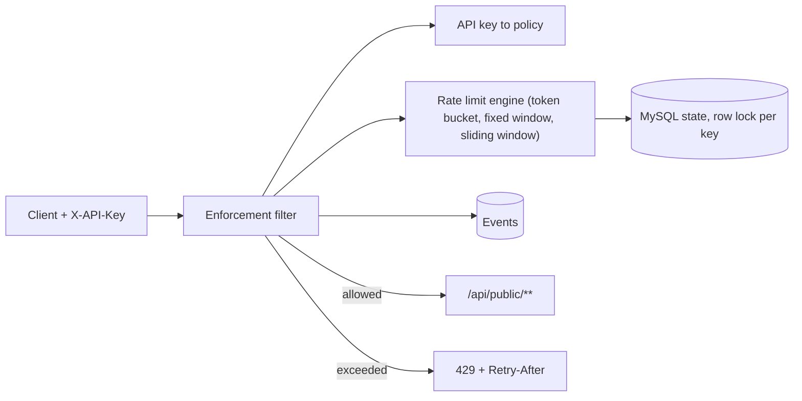

# Rate Limiter Dashboard

A rate-limiting service with a management dashboard. Policies define the limits, API keys are bound to a policy, and requests to `/api/public/**` are actually enforced (HTTP 429 when the limit is exceeded). Every decision is stored as an event.

**Stack:** Spring Boot 3.5 (Java 25) · Angular 19 · MySQL 8.4 · Flyway · Caffeine cache · JWT in an HttpOnly cookie

## How enforcement works



Responses carry `Retry-After` and `X-RateLimit-*` headers. Event data (status, policy, timestamp) is derived server-side, never taken from the client.

## Run with Docker

```bash
cp .env.example .env    # then replace every placeholder
docker compose up --build
```

- App: http://localhost
- API: http://localhost:8080
- Swagger UI: http://localhost:8080/swagger-ui.html

Log in with `APP_SECURITY_USERNAME` / `APP_SECURITY_PASSWORD` from `.env`, or register a new account (role `USER`). Outside the `dev` profile the app refuses to start with default credentials or the default JWT secret.

## Run without Docker

Needs Java 25, Node 20 and MySQL on `localhost:3308` (database `rate_limiter`, `root`/`root`, development only). The `dev` profile seeds sample data; login is `admin` / `change-me`.

```bash
cd backend
mvn spring-boot:run "-Dspring-boot.run.profiles=dev"

cd frontend
npm install
npm start    # http://localhost:4200, proxies /api to :8080
```

## Try the enforcement

1. Log in, create a policy (e.g. fixed window, 5 requests per minute) and an API key bound to it. The key is shown once.
2. Call the protected endpoint repeatedly:

```bash
curl -i -H "X-API-Key: <your-key>" http://localhost:8080/api/public/ping
```

The sixth call within the window returns `429`.

## Tests

```bash
cd backend && mvn test                                        # integration tests need Docker (Testcontainers MySQL)
cd frontend && npm test -- --watch=false --browsers=ChromeHeadless
```

GitHub Actions runs the backend build and tests against MySQL, plus the frontend build and tests.

## Security model

- JWT in an `HttpOnly`, `SameSite=Strict` cookie. The `Secure` flag is enabled for HTTPS deployments; local HTTP Compose sets it to false. Logout revokes the token (denylist by `jti`).
- Login attempts are limited. Password reset tokens expire after 30 minutes and are single use.
- API keys are stored as SHA-256 hashes plus a display prefix. The full key is returned only once, at creation.
- Resources are scoped to their owner. Another user's client or setting returns 404 (covered by an integration test).
- The API is unversioned (everything under `/api`). A `/api/v1` prefix will be introduced with the first breaking contract change.

## Known limitations

- **Rate-limit state lives in MySQL** with a pessimistic lock per key. Fine for a demo, not for high per-key throughput. A production version would use Redis with atomic Lua scripts.
- **The login attempt limiter is in memory**, so it is per instance and bypassable with several instances.
- **Password reset is a development stub.** The link is returned in the API response and no email is sent.
- **CSRF protection is disabled** and relies on `SameSite=Strict`. The `Secure` cookie only works over HTTPS or `localhost`.
- **Swagger UI is public.** Restrict it before any real deployment.
- **No observability:** no metrics, tracing, correlation IDs or structured logs.
- **Frontend:** no central store, the auth guard calls `/api/auth/me` on each navigation, and accessibility and mobile layouts were not audited.
- **Alerts and Rate Limits:** the pages use recent event and policy data; dedicated alert-rule management and a separate rate-limit inventory are not implemented.
- **Roles:** only `USER` and `ADMIN`, with tenancy by owner username and no workspaces.
